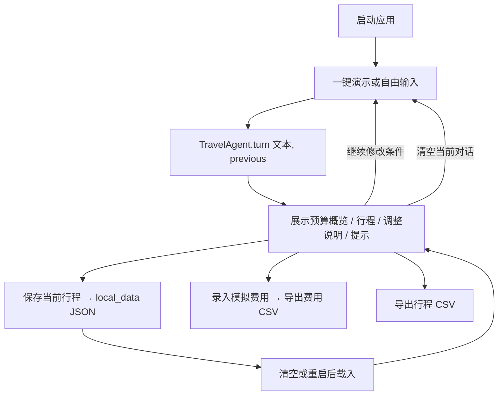

# 界面执行

## 1. 负责人 / 版本 / 基线

| 项目 | 内容 |
|---|---|
| 负责人 | C（界面与执行） |
| 基线 | 文斓前期 `前期工作/可视化界面入口.py`、`travel_agent/storage/`、`travel_agent/ui/`（提交 `57cd835`） |
| 当前版本 | `878c6ff`（2026-11-02） |
| 更新时间 | 2026-11-02（北京时间） |
| AI 辅助用途 | 用 AI 辅助阅读代码、起草 `app.py` 修改、离线测试和本文档；所有页面结果、截图和 CSV 由本人在本机实际操作获得并核对 |

**C 的交付文件**：`app.py`、`README.md`、`requirements.txt`、`.env.example`、`.gitignore`、`.streamlit/config.toml`、本文档。  
**C 补充修改的他人模块**（代码中以“C 补充 / C 修改”注释标出，已告知负责人）：`travel_agent/llm.py`（城市兜底、无“预算”字样金额、总人数、模型防护词表、中文金额省略写法）、`travel_agent/tools/weather.py`（恢复 Open-Meteo 真实查询）、`travel_agent/rules/planner.py` 与 `travel_agent/data/`（多城市、超预算自动调整、少走路、同日重复修复）、`travel_agent/service.py`（按收录城市分派）。

## 2. 页面信息架构

| 区域 | 内容 |
|---|---|
| 左侧：演示控制台 | “使用 DeepSeek API”开关（无密钥时禁用并说明原因）、“查询实时天气”开关（默认关闭）；一键演示 1–4（主线四轮）与 5（未收录城市）；清空当前对话；本地保存、已保存行程下拉框、载入 |
| 顶部 | 标题；标签：已收录城市列表、天气状态（未开启 / 已获取（来源）/ 未获取（原因））、费用为教学估算 |
| 中间：对话 | 消息记录、输入框、“调整出发日期”（选日期后重新规划） |
| 右侧：结果 | 标题“城市 · N 天”、数据覆盖说明、未确认默认条件；预算概览（总费用 / 预算 / 差额）与预算结论；调整说明 |
| 右侧页签 | 每日行程（天气提示、逐日卡片、警告、导出行程 CSV）· 预算（分项表）· 预订与提醒（待办勾选、到期提醒）· 执行轨迹（需求提取状态、合同版本、步骤）· 模拟报销（录入、表格、合计、导出费用 CSV） |

## 3. AgentResponse 字段与页面位置映射

页面只读取 `TravelAgent.turn()` 返回的 `AgentResponse`，不重算预算、不自行替换活动。

| 响应字段 | 页面位置 | 空 / 失败显示 | 是否导出 |
|---|---|---|---|
| `request.city`、`request.days` | 右侧标题 | — | 否 |
| `request.budget` | 预算概览“预算” | 未核实时不显示 | 否 |
| `request.assumed_fields` | 标题下灰字“以下条件为演示默认值……” | 为空时不显示 | 否 |
| `request.*`（整体） | 下一轮作为 `previous` 传回 | 清空时置空 | 保存到 JSON |
| `coverage` | 标题下灰字 | — | 否 |
| `budget_status` | 决定预算区域：`estimated_within_budget` 绿色；`estimated_over_budget` 红色；`unverified` 黄色提示且隐藏总价与差额 | 缺失或未知值按 `unverified` 处理 | 保存到 JSON |
| `total_cost` | 预算概览“教学估算总费用”；差额 = 预算 − 总费用（负数显示 `-¥`） | `unverified` 时不显示（兼容占位 0 不展示） | 否 |
| `within_budget` | 不直接使用（以 `budget_status` 为准） | — | 保存到 JSON |
| `budget_items` | “预算”页签表格 | 未核实时显示“没有可核实报价” | 否 |
| `changes` | 绿色“调整说明” | 为空不显示 | 否 |
| `warnings` | “每日行程”页签黄色提示（与天气摘要重复的一条不再显示） | 为空不显示 | 否 |
| `weather.status` / `summary` / `source` | 顶部天气标签；“每日行程”页签首条提示（`ok` 蓝色并标来源，`disabled` 蓝色说明，其他黄色并写中文原因） | 未知状态原样显示状态值 | 否 |
| `weather.daily` | 每天卡片“天气预报（日期）：天气 · 气温 · 降水概率” | 非 `ok` 时不显示 | 否 |
| `itinerary[].day` / `date` | 卡片标题 | 无日期时只显示“第 N 天” | 行程 CSV“天数”“日期” |
| `itinerary[].rainy` / `rain_source` | 卡片灰字“雨天调整 · 来源” | 非雨天不显示 | 行程 CSV“雨天状态”（写入来源） |
| `itinerary[].activities[].name` | 卡片景点列表 | — | 行程 CSV“景点” |
| `itinerary[].activities[].price_per_person` | 不在卡片显示 | `None` 时 CSV 写“未核实” | 行程 CSV“费用估算/人” |
| `itinerary[].note` | 卡片底部灰字 | 为空不显示 | 行程 CSV“备注” |
| `booking_tasks[]` | “预订与提醒”勾选框；截止日为有效日期且已到、未勾选时显示“到期提醒” | 截止日为文字（如“待确定出发日期”）时不提醒 | 否 |
| `trace[]` | “执行轨迹”页签编号列表 | — | 否 |
| `extraction_status`、`schema_version` | “执行轨迹”页签顶部灰字 | 空时显示“未记录” | 否 |
| `answer` | 对话区助手消息 | 调用异常时显示“这次处理失败，已保留上一轮结果。错误类型：…” | 否 |

## 4. 用户操作流程

| 步骤 | 操作 | 证据 |
|---|---|---|
| 1 | 打开页面 | 素材包 `screenshots/01-入口.png` |
| 2–5 | 一键演示 1–4（主线四轮） | `02`、`03`、`04`、`05` |
| 6 | 预订与提醒 | `06-待办.png` |
| 7 | 保存 → 清空 → 载入 | `07a-保存.png`、`07b-载入.png` |
| 8 | 录入模拟费用、导出两类 CSV | `08a-录入费用.png`、`08b-导出.png`、`exports/*.csv` |
| 9 | 未收录城市 | `09-异常提示.png` |

> 截图与 CSV 位于 C 素材包 `C-报告素材-20261102-1915.zip`（已私聊交文斓），逐步记录见包内 `walkthrough.md`。

**三类事项的区别**：“到期提醒”只在应用打开且截止日已到时显示于页面；“预订待办”是人工核对清单，勾选不保存；“模拟费用”是教学演示账本，不对应真实凭证或报销。

## 5. 保存 / 载入 / CSV 数据流

| 操作 | 数据流 | 实际范围 |
|---|---|---|
| 保存 | `st.session_state.result` → `restore_response()` 还原为 `AgentResponse` → `save_trip()` → `local_data/<时间>-<随机>.json` | 完整响应：需求、天气、行程、预算与状态、调整说明、提示、待办、轨迹、回复 |
| 载入 | `list_trips()` 列出 → `load_trip()`（仅允许 `local_data` 下的 `.json`）→ `restore_response()` → 写回会话 | 恢复行程结果与需求条件；对话只追加一条提示；费用与勾选不恢复 |
| 行程 CSV | `itinerary_csv(result)` | 每个景点一行：天数、日期、景点、费用估算/人、雨天状态、备注；UTF-8 带 BOM |
| 费用 CSV | `expense_csv(st.session_state.expenses)` | 日期、类别、金额、备注、凭证状态 + 合计行；UTF-8 带 BOM |

| 场景 | 保留情况（2026-11-02 实测） |
|---|---|
| 浏览器刷新 | 对话、行程、费用全部清空 |
| 重启服务 | 页面清空；已保存文件仍在，可载入 |
| 清空当前对话 | 清除对话、行程、费用；不影响已保存文件 |

## 6. 空值与异常态

| 情形 | 页面显示 | 状态 |
|---|---|---|
| 空输入（只有空格） | 忽略，不产生消息 | 实测通过 |
| 智能体抛出异常 | 保留上一轮结果，对话提示错误类型 | 离线页面测试通过 |
| 未收录城市（杭州） | 黄色“缺少可核实报价”，不显示总价、差额与预算结论 | 实测通过 |
| 超预算 | 红色“教学估算超出预算”，差额显示 `-¥`；警告给出最低估算 | 离线页面测试通过 |
| 天气关闭 | 标签“未开启查询”，蓝色说明 | 实测通过 |
| 天气未获取 | 标签“未获取（原因）”；黄色“未获取天气（未提供出发日期 / 出发日期已过 / 超出可查询范围 / 暂不支持该城市 / 数据不完整 / 查询失败）” | 离线测试覆盖；开发环境实测“已获取” |
| 无密钥 | DeepSeek 开关禁用，并说明需在 `.env` 配置 | 实测通过 |
| 载入文件损坏或路径非法 | 显示“载入失败：错误类型” | 源码存在但未测 |
| 换新行程 | 待办勾选框全部重置（key 随结果编号变化） | 离线页面测试通过 |

## 7. 测试证据

| 命令 / 输入 | 预期 | 实测 | 证据路径 | 状态 |
|---|---|---|---|----|
| `python -B -m unittest discover -s tests -v` | 全部通过 | 71 个通过（含 A 的 49 个） | 本机终端输出，待贴入 | 通过 |
| 新建虚拟环境 `pip install -r requirements.txt`，`streamlit run app.py` | 页面启动 | 启动成功（Windows 11，Python 3.13.12，Streamlit 1.66.1） | 素材包 `README.md` | 通过 |
| 主线四轮（无 Key，天气关闭） | 2790 → 2830 → 2070 → 1970，预算内 | 一致 | 素材包 `walkthrough.md` #2–#6 | 通过 |
| 保存 / 载入 | 第 4 轮结果完整恢复 | 一致 | 素材包 `07a`、`07b` | 通过 |
| 两类 CSV 与页面核对 | 条目、金额、合计一致 | 一致（合计 138） | 素材包 `export_check.md` | 通过 |
| 未收录城市 | 不显示总价 | 一致 | 素材包 `09-异常提示.png` | 通过 |
| 刷新 / 重启 / 空输入 | 见第 5、6 节 | 一致 | 素材包 `persistence.md` | 通过 |
| 实时天气（联网，选 16 天内日期） | 显示 Open-Meteo 逐日天气 | “已读取 Open-Meteo 逐日天气预报” | 开发环境 2026-10-29，早于当前版本 | 通过（旧版本） |
| DeepSeek 真实调用（`deepseek-flash`） | 轨迹显示已提取需求 | “DeepSeek deepseek-flash 已提取需求” | 开发环境 2026-10-29，早于当前版本 | 通过（旧版本） |
| 当前版本联网天气、DeepSeek | — | — | — | 通过 |

## 8. 已知限制与交接

**限制**

- 预算表与费用表表头为程序字段名（category / amount / detail / date / note），未翻译。
- “默认值未确认”在顶部灰字与行程页签黄色提示中重复出现。
- 费用记录不能单条修改或删除，只能随清空一并清除。
- 行程 CSV 的“雨天状态”列实际为雨天来源；CSV 不含预算总额、天气和调整说明。
- 提醒只在应用打开时显示；无出发日期时不提醒。
- 价格为教学估算，不含城际交通；仅 6 个城市有样例数据。

**交接**

- 给 A：`llm.py`、`service.py` 中的 C 补充见注释；`schema_version` 服务层未填写，页面显示为 1.0。
- 给 B：多城市数据见 `travel_agent/data/*.json` 与 `docs/qa/数据来源表-新增城市.md`，需合并进数据来源表；超预算场景和成都第 4 轮（现为 1970 元）的预算复算需按当前版本更新。
- 给文斓：截图与导出样例见 C 素材包；页面事实以本文档和素材包为准。
