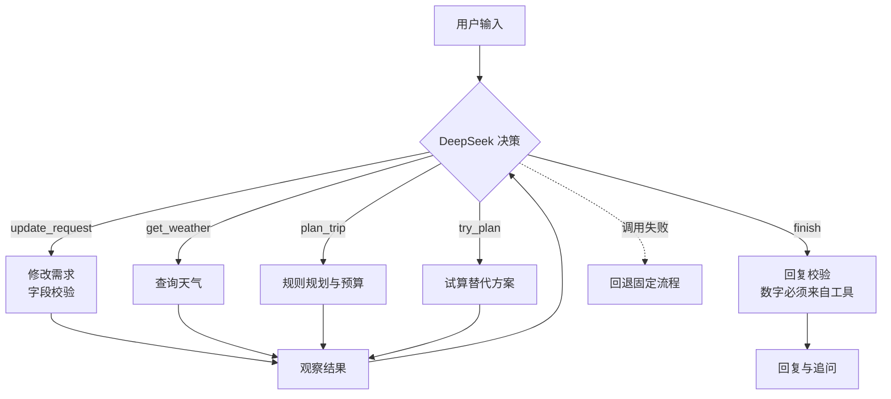

# C → 文斓 交接：11-02 素材包之后的变化

交接人：C　接收人：文斓　日期：2026-11-05（北京时间）  
素材包版本：`878c6ff`（C-报告素材-20261102-1915.zip）　当前：main 最新提交（推送后由 C 填写：`______`）

## 1. 结论先行

- **素材包中的截图、CSV、主线四轮数字（2790 → 2830 → 2070 → 1970）仍然有效**，无 Key 模式下页面与当时一致。
- **新增 Agent 模式**：DeepSeek 自主调用工具完成规划，回答“项目哪里用了 Agent”。报告和 PPT 建议补一节（第 3 节）。
- 新增真实模型调用证据（此前所有材料都写“未测”）。

## 2. 11-02 之后的变化

| 变化 | 影响素材包吗 | 报告需要改吗 |
|---|---|---|
| Agent 模式（有 Key 时默认开启，页面左侧新增开关） | 否（素材为无 Key 模式） | 是，新增一节 |
| 本地规则识别亲属称呼（“带着老爸老妈”→ 2 位老人） | 否 | 可选，写进“需求理解”能力 |
| 雨天替换避免跨天重复 | 否（成都主线不受影响） | 否 |
| README、界面执行.md 增加 Agent 模式说明 | — | 引用即可 |
| 离线测试 71 → 84 个 | — | 测试数字改为 84 |

## 3. 报告 / PPT 建议新增：“Agent 决策过程”

**一句话定位**：DeepSeek 是决策者，规则和数据是工具；模型决定做什么，工具负责算准。

**工具**：修改需求、查询收录城市、查询天气、规划行程、试算方案、结束回复（共 6 个）。

**实测案例**（`docs/evidence/agent-live-20261104-224159.json`，真实调用，天气关闭）：

| 轮次 | 用户 | Agent 的步骤 | 结果 |
|---|---|---|---|
| 1 | 国庆后带着老爸老妈去上海玩三天，别太累，预算3000左右 | 修改需求（上海、3天、成人1、老人2、舒缓）→ 规划 → 回复 | 2580 元，预算内；追问出发日期与出发地 |
| 2 | 第二天好像要下雨 | 修改需求（第2天雨）→ 规划 → 回复 | 第 2 天改为中华艺术宫、上海科技馆；2595 元 |
| 3 | 预算再降到2000 | 修改需求（预算2000）→ 规划（超出 460，已是最低方案）→ **试算 2 天（1560 元）** → 回复 | 不擅自改天数，给出“缩短到 2 天 / 提高预算”两个方案让用户选 |

第 3 轮是展示 Agent 的最佳例子：模型观察到超预算，自主决定试算替代方案，再把选择交给用户。

**可信机制**（建议放在同一页）：价格与天气只由工具计算；回复中出现工具结果之外的数字会被拦截并改用模板；模型失败自动回退固定流程。

**流程图（Mermaid，可直接用）**

## 4. 需要补拍的截图（素材包中没有）

| 文件名建议 | 操作 | 截什么 |
|---|---|---|
| `10-Agent执行轨迹.png` | 有 Key，开启 DeepSeek 和 Agent 模式，依次输入第 3 节的三句话，停在第 3 轮 | “执行轨迹”页签：Agent 第 1–4 步（含 try_plan）和“回复校验” |
| `11-Agent回复.png` | 同上 | 对话区第 3 轮回复（两个方案 + 追问） |
| `12-Agent开关.png` | 同上 | 左侧 DeepSeek 与 Agent 模式开关 |

截图需在联网且有 Key 的电脑上拍，画面中不能出现 `.env` 或密钥。C 可以负责拍摄。

## 5. 证据文件

| 文件 | 内容 |
|---|---|
| `docs/evidence/agent-live-20261104-214619.json` | 第一次真实 Agent 调用（修复前，暴露两个问题） |
| `docs/evidence/agent-live-20261104-224159.json` | 修复后的三轮真实调用，报告引用这一份 |
| `docs/modules/界面执行.md` | C 模块说明（含 Agent 开关与轨迹显示） |
| `README.md` 第 5 节 | 有 Key 配置、Agent 模式、真实调用检查命令 |

## 6. 答辩演示建议

- **主线**照旧用无 Key 模式演示（不依赖网络，最稳）。
- **Agent 环节**：现场联网、有 Key 时演示第 3 节三句话并打开“执行轨迹”；网络不可靠时改为展示证据 JSON 和截图，不现场调用。
- 预期提问：“Agent 体现在哪？”“怎么防止模型编造价格？”“没网怎么办？”——答案见 `C-交接-A.md` 第 7 节。

## 7. 贡献记录说明

C 在 11-02 之后修改了 A 的 `llm.py`、`service.py`（新增 `agent_loop.py`）和 B 的 `planner.py`、`weather.py`、数据文件，改动处均有注释标注，详见 `C-交接-A.md`、`C-交接-B.md`。按总表要求，相关提交说明中注明 AI 辅助用途与本人核验（测试运行、真实调用、页面走查）。
